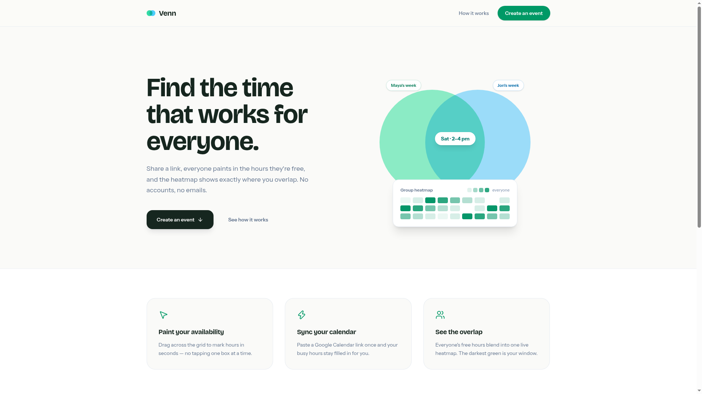

<div align="center">

# Venn

**Find the time that works for everyone.**

Share a link, everyone paints in the hours they're free, and a live heatmap shows exactly where you overlap. No accounts, no emails, no back-and-forth.

[**Live demo**](https://TheMinescout.github.io/venn/) · [Features](#features) · [Getting started](#getting-started) · [How it works](#how-it-works) · [Deployment](#deployment)

[](https://github.com/TheMinescout/venn/actions/workflows/deploy.yml)


</div>



## Features

- **Paint your availability.** Drag across the grid with a mouse, finger, or stylus to mark whole ranges of free time in one gesture. Start a drag on a green block to erase.
- **Group heatmap.** Everyone's free hours blend into a single view. Hover or tap a block to see who is free and who is busy at that time.
- **Calendar sync.** Paste a public Google Calendar link and Venn fills in the busy hours for you, optionally ignoring all-day events.
- **Live updates.** Availability is stored in Supabase and streamed to every open tab, so the heatmap updates as people paint.
- **No accounts.** People identify themselves with a name. An optional password lock stops others from editing under that name.
- **Flexible windows.** Pick a date range and a slot size of 15, 30, or 60 minutes; navigate long events week by week.
- **Quick actions.** Select all, invert, or clear your schedule in one click.

## Tech stack

| Layer    | Choice                                                       |
| -------- | ------------------------------------------------------------ |
| UI       | React 19 + Vite 8                                            |
| Styling  | Tailwind CSS 4 (with a small custom theme in `src/index.css`) |
| Data     | Supabase (Postgres + Realtime)                               |
| Calendar | `ical.js` for parsing ICS feeds                              |
| Icons    | `lucide-react`                                               |
| Hosting  | GitHub Pages, deployed by GitHub Actions                     |

## Getting started

### Prerequisites

- Node.js 22 or newer
- npm 10 or newer
- A Supabase project (see [Database setup](#database-setup))

### Install and run

```bash
npm install
npm run dev
```

Vite prints a local URL, usually <http://localhost:5173/venn/>. The app is served under `/venn/` to match the GitHub Pages base path.

### Environment variables

Create `.env.local` in the project root:

```bash
VITE_SUPABASE_URL=https://your-project.supabase.co
VITE_SUPABASE_ANON_KEY=your-anon-key
```

Both values are read in `src/supabase.js` at build time. The anon key is designed to be public in the browser; protect your data with Row Level Security instead of hiding it.

### Scripts

| Command           | What it does                                   |
| ----------------- | ---------------------------------------------- |
| `npm run dev`     | Start the Vite dev server with HMR             |
| `npm run build`   | Build production assets into `dist/`           |
| `npm run preview` | Serve the production build locally             |
| `npm run lint`    | Run ESLint over the project                    |
| `npm run deploy`  | Publish `dist/` to the `gh-pages` branch manually |

## How it works

1. **Create an event.** Give it a name, a date range, and a slot size. Venn generates a short group id and puts it in the URL hash, e.g. `/#/a1b2c3d4e5f6`.
2. **Share the link.** Anyone who opens it joins the same event. No sign-up.
3. **Paint availability.** Each person drags over the hours they are free. Slots are stored as `<date>-<HH:MM>` block ids, which makes writes idempotent and easy to batch.
4. **Read the overlap.** The group heatmap colours each slot by how many people are free, and the side panel lists names for the selected slot.

Writes are chunked to keep requests small, and "invert" and calendar sync add the new slots before deleting the old ones, so a failed request never wipes a schedule.

## Database setup

Venn expects three tables in Supabase. The columns below are the ones the app reads and writes.

```sql
-- One row per event.
create table groups (
  id          text primary key,
  title       text not null,
  start_date  date not null,
  end_date    date not null,
  granularity int  not null default 60   -- minutes per slot: 15, 30 or 60
);

-- One row per person per free slot.
create table squad_blocks (
  group_id  text not null references groups (id) on delete cascade,
  block_id  text not null,               -- "<date>-<HH:MM>", e.g. 2026-03-05-14:00
  user_name text not null,
  primary key (group_id, block_id, user_name)
);

-- Per-name settings: password hash and calendar preference.
create table user_settings (
  user_name      text primary key,
  password       text not null default '', -- SHA-256 hex, empty means unprotected
  ignore_all_day boolean not null default true
);

-- Stream squad_blocks changes to connected clients.
alter publication supabase_realtime add table squad_blocks;
```

Because Venn has no accounts, the `anon` role needs select, insert, update, and delete on these tables. Enable RLS and add policies that allow that model, or the app cannot save availability. Password protection is a convenience lock, not an authentication boundary: hashes are computed in the browser with SHA-256.

## Project structure

```
.
├── .github/workflows/deploy.yml   # Build and publish to GitHub Pages
├── docs/screenshot.png            # Screenshot used in this README
├── public/                        # Favicon and icon sprite
├── src/
│   ├── main.jsx                   # React entry point
│   ├── App.jsx                    # Mounts the heatmap view
│   ├── index.css                  # Tailwind import, theme tokens, animations
│   ├── supabase.js                # Supabase client from environment variables
│   └── components/
│       └── Heatmap.jsx            # Landing page, event creation, grid, heatmap
├── index.html
├── vite.config.js                 # React + Tailwind plugins, base path /venn/
└── package.json
```

## Deployment

Every push to `main` runs [`.github/workflows/deploy.yml`](.github/workflows/deploy.yml). The workflow installs dependencies, builds the site, and force-pushes `dist/` to the `gh-pages` branch, which GitHub Pages serves at <https://TheMinescout.github.io/venn/>.

If you fork the repo, update the `base` option in `vite.config.js` and the `homepage` field in `package.json` to match your repository name.

## Contributing

1. Create a branch off `main`.
2. Make your change and run `npm run lint` and `npm run build`.
3. Open a pull request describing what changed and why.

Bug reports and feature ideas are welcome in [Issues](https://github.com/TheMinescout/venn/issues).
